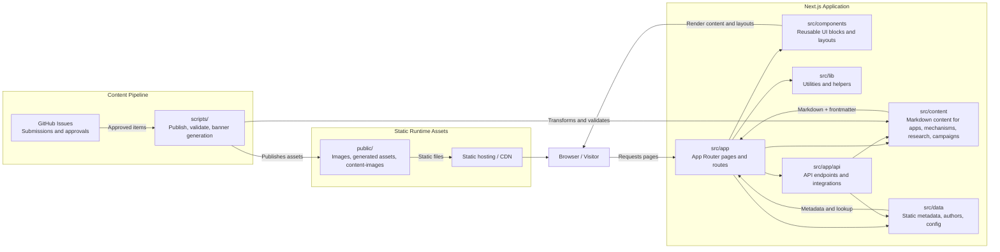

# Architecture Overview

This repository is a Next.js-based content platform for public goods funding discovery. The architecture combines a content-driven App Router frontend, reusable UI components, automation scripts for publishing from GitHub issues, and static/public assets for images and generated content.

## Key Architectural Layers

- Frontend: Next.js App Router in `src/app` handles routes such as home, apps, mechanisms, research, campaigns, and preview pages.
- UI Layer: `src/components` contains reusable cards, layouts, search, impact sections, and markdown rendering helpers.
- Content Layer: `src/content` stores the actual application content in structured markdown files, while `src/data` holds supporting metadata.
- Publishing Automation: `scripts/` validates content, generates banners, and syncs content from issue-driven workflows.
- Static Assets: `public/` stores images, generated content images, and other files served directly by the app.

## Runtime Flow

1. A user visits a route in the app.
2. The Next.js router loads the relevant page and associated components.
3. Content is read from `src/content` and metadata from `src/data`.
4. Reusable UI components render cards, detail pages, and sections.
5. Static public assets are served for banners, logos, and images.
6. Content contributors can submit or update entries via GitHub Issues, which are then processed by automation scripts.
